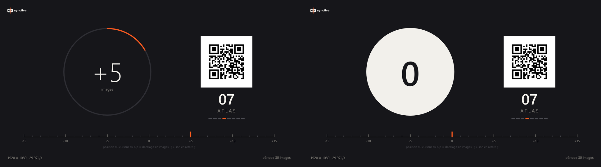
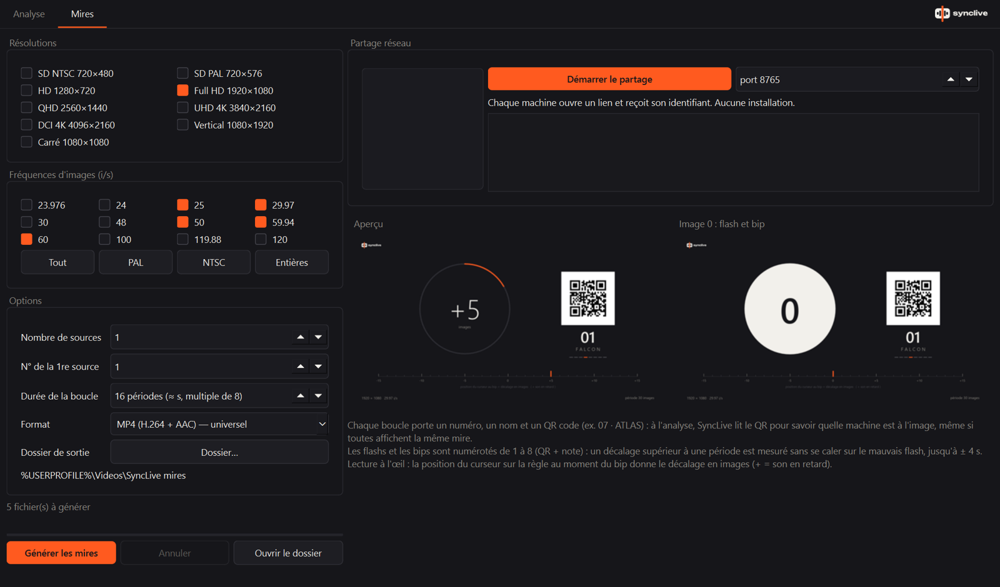

<p align="center">
  
</p>

<p align="center">
  Mesure le décalage son / image de chaque source d'une vidéo (caméras, PC, consoles)<br>
  et indique quoi corriger, en millisecondes et en images.<br>
  Met aussi les médias d'une régie au même niveau sonore, et coupe un live entier sans perte.
</p>

---

## Principe

L'application a quatre onglets :

- **Analyse** : mesure du décalage son / image de chaque source (ci-dessous) ;
- **Mires** : génération et partage réseau des mires SyncLive ;
- **Normalisation** : tous les médias (clips de 1 à 3 min) au même niveau sonore ;
- **Montage** : couper un live entier (plusieurs heures) sans perte, à la vitesse du disque.

Mesure du décalage :

1. Devant chaque caméra, on fait quelques **claps**. Sur chaque PC ou console, on lance une **mire SyncLive**.
2. On enregistre le programme (OBS, mélangeur, enregistreur…).
3. On glisse l'enregistrement dans SyncLive.

SyncLive retrouve chaque source, mesure son décalage et produit un **plan de correction** :

```
SON : retarder de 118 ms · 3,5 img (réglage global, une seule fois pour toutes les sources)
CAM 1       IMAGE EN RETARD de 118 ms · 3,5 img   ->  IMAGE : aucun retard à mettre
CAM 3       IMAGE EN RETARD de 98 ms · 2,9 img    ->  IMAGE : retarder de 1 img · 33 ms
07 · ATLAS  SON EN RETARD de 148 ms · 4,4 img     ->  IMAGE : retarder de 8 img · 267 ms
```

Le son étant commun à toutes les sources, on ne peut que le retarder, une seule fois, de la plus grande
avance mesurée. Chaque source d'image reçoit ensuite le retard qui lui manque, en images entières, avec
l'écart restant après arrondi.

## Fonctionnalités

**Analyse**
- Glisser-déposer d'une vidéo (formats : voir [Formats pris en charge](#formats-pris-en-charge)),
  toutes fréquences d'images (23.976 à 120 i/s, VFR) : les calculs utilisent les timestamps réels
  du fichier.
- Découpe en plans et regroupement des plans par source. Deux sources qui affichent la même image
  (même mire sur deux PC) sont séparées par leur QR code et par leur décalage, même sans coupe visible.
- **Claps** : instant où les mains s'arrêtent net, avec une précision meilleure qu'une image.
  La zone des mains est ciblée automatiquement, avec l'aide de MediaPipe quand les mains sont visibles.
- **Mires** : flash d'une image, mesuré à l'échantillon audio près.
- **Caméras lentes** : une caméra qui filme moins d'images que le fichier (20 i/s dans un fichier
  à 59.94, image recopiée 2 ou 3 fois) est reconnue ; seules ses vraies images comptent, et la
  marge de mesure suit sa vraie cadence.
- Résultats robustes (médiane, dispersion, indice de confiance) et corrections manuelles :
  renommer, fusionner, déplacer un plan, exclure un clap, choisir un autre candidat, **supprimer
  une source** où il ne se passe rien (« Annuler la dernière modification » la remet).
- **Régler l'image du clap à la main** : lecteur avec le son (▶ / Espace, ×1, ×½, ×¼), une timeline
  avec la forme d'onde, les sons détectés comme claps et l'image choisie, une bande d'images
  (9, 15 ou 21), « Zoom sur les mains » et « Éclaircir ». L'image où l'on clique, relâche ou met
  pause devient l'image du clap ; une fois validée, elle fait la mesure de la source et la carte
  de la source montre cette image.
- Export : une image annotée par source, un récapitulatif, `plan_correction.csv`,
  `rapport_claps.csv` et `rapport.json`.

**Mires SyncLive**
- Toutes résolutions (SD PAL/NTSC, 720p, 1080p, 1440p, UHD, DCI 4K, vertical, carré) et
  fréquences (23.976, 24, 25, 29.97, 30, 48, 50, 59.94, 60, 100, 119.88, 120).
- Un flash d'une seule image et un bip à chaque période (≈ 1 s).
- Chaque source porte un identifiant (`07 · ATLAS`, jusqu'à 99) en clair et dans un QR code.
- Flashs et bips numérotés sur un cycle de 8 (le numéro est dans le QR et dans la note du bip) :
  un décalage supérieur à une période est mesuré sans ambiguïté, jusqu'à ± 4 s.
- Règle −15…+15 images pour une lecture à l'œil.
- Boucle sans couture, en MP4 (H.264 + AAC) ou MOV (H.264 + PCM 24 bits).
- Format par défaut : Full HD 1920×1080 à 59.94 i/s.

**Normaliser le son (onglet Normalisation)**
- En régie, des médias de toutes provenances au même niveau, pour que l'ingé son n'ait plus
  d'écart de volume d'une vidéo à l'autre. On glisse des fichiers ou des dossiers entiers ;
  chacun est mesuré aussitôt (EBU R128 / ITU-R BS.1770 : niveau intégré en LUFS, crête vraie en
  dBTP, dynamique LRA) et l'écart à la cible s'affiche sur sa ligne.
- Cibles : EBU R128 — diffusion TV (−23 LUFS), plateau / live / streaming (−16), web / réseaux
  sociaux (−14) ou personnalisée, crête max réglable (−1 dBTP par défaut).
- Gain linéaire (la dynamique ne change pas). Si ce gain ferait dépasser la crête max, un
  limiteur de crête vraie (anticipation, canaux liés) abaisse seulement ces passages, de 6 dB au
  plus : au-delà le son serait écrasé, le fichier reste alors sous la cible et l'app le dit.
- « Cible commune » règle la cible au niveau le plus haut que **tous** les fichiers peuvent
  atteindre : tout le lot finit au même niveau.
- Chaque piste son d'un fichier est corrigée séparément ; le canal LFE d'un 5.1 n'est pas compté.
- La vidéo n'est **jamais réencodée** : ses paquets sont recopiés tels quels, sans aucune perte de
  qualité. Le son est réencodé dans le même format (voir ci-dessous), au même instant de départ :
  la synchro son / image est intacte.
- Chaque fichier écrit est remesuré ; si l'encodeur a fait bouger le niveau ou la crête, il est
  refait automatiquement. Les fichiers corrigés vont dans un dossier « normalisé » à côté de
  chaque original, ou tous dans un dossier choisi (`clip_norm-23LUFS.mp4`).
- Mesure rapide : une seule lecture du fichier pour toutes ses pistes (84 s de vidéo à 6 pistes
  son : 1,5 s).

**Montage d'un live entier (onglet Montage)**
- Pour un live de plusieurs heures : enlever le début, la fin, les écrans d'attente ou de pause,
  couper en morceaux, en supprimer, les remettre dans un autre ordre.
- **Ouverture immédiate**, même pour 6 h : rien n'est lu en entier. Les images clés sont
  cherchées à la demande (quelques ms) ; l'aperçu du son se remplit en tâche de fond.
- **La timeline est le montage**, comme dans un logiciel de montage : les morceaux gardés bout à
  bout, en temps du montage. Supprimer un morceau recolle les suivants ; la lecture enchaîne les
  morceaux. Marqueurs **DÉBUT** et **FIN** du montage (instant dans le montage, et instant correspondant dans le
  fichier d'origine), raccords marqués ✂, son de chaque morceau ; molette : zoom.
- Lecteur avec le son ; aperçu de l'image **en temps réel** quand on glisse dans la timeline.
- Clavier : Espace lecture / pause, ← → **image par image** (à travers les raccords), Maj+← → 1 s,
  , . image clé précédente / suivante. Se déplacer pendant la lecture met en pause (l'image suit)
  et la lecture reprend une seule fois au nouvel endroit.
- « Début ici » (I) et « Fin ici » (O) enlèvent ce qui est avant / après la tête dans le montage,
  « Couper ici » (C), « Supprimer le morceau » (Suppr), déplacer un morceau (glisser dans la liste,
  ou ◀ ▶), Ctrl+Z.
- Sans réencodage, une vidéo ne se coupe proprement que sur ses **images clés** (une toutes les
  0,5 à 2 s en général) : les coupes s'y calent et la tête de lecture y saute pour montrer
  l'image exacte de la coupe.
- **Export sans perte, à la vitesse du disque** : vidéo et son recopiés tels quels, en une seule
  lecture. Live de 3 h (8,4 Go, 1080p60) dont on enlève 15 min au début, au milieu et à la fin :
  **10 s**, vidéo identique au bit près. Le son recopié ne se coupe qu'entre ses paquets
  (≈ 21 ms en AAC) : à chaque raccord l'écart reste sous ½ paquet (≈ 10 ms, moins d'une image)
  et ne s'accumule pas.
- Option « son recalculé à l'échantillon près » : synchro exacte, son réencodé dans le même
  format (≈ 4 min pour 3 h), vidéo toujours recopiée.

**Multiview maison**
- Une mosaïque de caméras bord à bord, sans séparateur, est découpée automatiquement en vignettes :
  chaque vignette devient une source. Un seul clap vu par toutes les caméras donne le décalage de
  chacune ; claps et bips de mire peuvent se suivre dans la même bande son.

**Partage réseau**
- SyncLive affiche un lien et un QR code. Chaque machine ouvre le lien dans son navigateur, reçoit
  son identifiant, puis lance la boucle en plein écran ou télécharge le MP4. Aucune installation.
- Le n° de chaque machine se change à distance, directement sur sa ligne.

**Sans réglage, à jour tout seul**
- Aucun réglage : piste audio et sensibilité sont choisies automatiquement.
- Au démarrage, SyncLive vérifie la dernière version publiée et propose la mise à jour
  (téléchargement, contrôle SHA-256, installation et redémarrage automatiques).

## Formats pris en charge

SyncLive lit tout ce que lit FFmpeg (embarqué) :

| | Formats |
|---|---|
| **Vidéos** | MP4, MOV, M4V, MKV, WebM, AVI, MXF, TS, MTS, M2TS, MPG / MPEG, FLV, WMV, 3GP |
| **Codecs vidéo** | H.264, H.265 / HEVC, ProRes, DNxHD / DNxHR, MPEG-2, VP9, AV1, et les autres codecs de FFmpeg |
| **Son seul** (onglet Normalisation) | WAV, AIFF, FLAC, MP3, M4A / AAC, OGG (Vorbis, Opus), WMA |
| **Son** | mono, stéréo, 5.1 et plus ; plusieurs pistes son par fichier |

Fichiers écrits par les onglets Normalisation et Montage : même conteneur, vidéo recopiée telle quelle.
Onglet Montage : son recopié tel quel (ou recalculé, au choix). Onglet Normalisation : le son est réencodé
dans sa famille de codec :

| Son d'origine | Son écrit |
|---|---|
| PCM (WAV, MOV, MXF…) | même PCM (16 ou 24 bits) |
| FLAC, ALAC | même codec (sans perte) |
| AAC | AAC, au moins 256 kb/s en stéréo (96 kb/s par canal au-delà) |
| MP3 | MP3 320 kb/s |
| MP2 (MPG, VOB) | MP2, au moins 384 kb/s |
| Opus | Opus |
| Vorbis | Vorbis |
| WMA | WMA, au moins 192 kb/s |
| AC-3, E-AC-3 | AC-3, au moins 448 kb/s |

Si un conteneur refuse l'encodeur prévu, un autre est essayé automatiquement (AAC, MP2, PCM…).
Les sous-titres et pistes de données ne sont pas recopiés.

<p align="center"></p>
<p align="center"></p>

## Installation

**Utilisateurs** : télécharger
[`SyncLive-windows-x64.zip`](https://github.com/ElementV2/synclive/releases/latest/download/SyncLive-windows-x64.zip)
(toujours la dernière version), extraire, lancer `SyncLive.exe`. Rien d'autre à installer.
Historique : [CHANGELOG.md](CHANGELOG.md).

**Développement** : Windows 10/11, Python 3.11.

```bat
python -m venv .venv
.venv\Scripts\pip install -r requirements-dev.txt
.venv\Scripts\python main.py
dev.bat                       :: mode dev : l'interface se relance à chaque modification du code
```

Exécutable autonome (`dist\SyncLive\SyncLive.exe`) :

```bat
build.bat
```

## Utilisation en ligne de commande

```bat
python -m synclive.cli video.mp4 -o dossier_sortie
SyncLive.exe --cli video.mp4 -o dossier_sortie
```

Options : `--max-offset` (ms), `--audio-track`, `--sensitivity`, `--group-threshold`,
`--cut-threshold`, `--no-hands`.

## Conventions

- `décalage = t_son − t_image`
  - négatif : **image en retard** (le son arrive avant l'image) ;
  - positif : **son en retard** (le son arrive après l'image).
- Les retards d'image sont exprimés en images entières à la fréquence de l'enregistrement, et en ms
  (OBS : filtre « Délai de rendu »).

## Conseils de tournage

- Devant chaque caméra, taper 3 à 5 fois dans ses mains, fort et net (un coup bref, pas un
  applaudissement mou), mains visibles et éclairées, environ 1 s entre deux claps.
- Au moins 2 s de plan stable par source.
- Avec un seul clap par caméra, la mesure est donnée en confiance « faible » : vérifie-la dans
  l'onglet *Détail*.
- Le navigateur ajoute sa propre latence audio : si une machine lit ses médias avec un autre lecteur
  en production, télécharge le MP4 et lis-le en boucle avec ce lecteur.

## Tests

```bat
.venv\Scripts\python -m pytest
```

Les tests génèrent des vidéos synthétiques à décalage connu : claps à 25, 29.97 et 60 i/s ; caméra
lente ; mires avec sources identiques, latences différentes et décalages supérieurs à une période ;
MP4/AAC ; partage réseau ; plan de correction ; gestes du réglage du clap (clic, glisser, flèches,
molette, lecture et pause).

Onglet Normalisation : mesure comparée aux signaux de test EBU (Tech 3341) ; médias générés au hasard
(`tests/media_gen.py` : musique, parole, pub, ambiance, de −60 à −8 dB, en MP4/AAC, MOV/PCM 24 bits,
MKV/Opus, MXF, WAV, MP3 et 5.1) normalisés, avec contrôle du niveau, de la crête, de la vidéo
(paquets identiques au bit près) et de la synchro (à l'échantillon).

Onglet Montage : ouverture, images clés, export en copie et en son recalculé, morceaux dans le
désordre, en MP4/AAC, MOV/PCM, MKV/Opus et MXF : durée, vidéo identique au bit près, synchro de
chaque morceau ; gestes de l'onglet (glisser le fichier, I, O, C, Suppr, déplacer, Ctrl+Z, export).

## Structure

| Fichier | Rôle |
|---|---|
| `synclive/media.py` | décodage audio/vidéo (PyAV), analyse du mouvement |
| `synclive/audio_claps.py` | détection des claps et des bips |
| `synclive/shots.py` | coupes et regroupement par apparence |
| `synclive/visual.py` | instant visuel des claps et des flashs |
| `synclive/hands.py` | localisation des mains (MediaPipe) |
| `synclive/analysis.py` | pipeline, sources, QR, numérotation des bips |
| `synclive/export.py` | plan de correction, images annotées, rapports |
| `synclive/pattern.py` | générateur de mires |
| `synclive/server.py` | partage réseau |
| `synclive/multiview.py` | découpe des mosaïques en vignettes |
| `synclive/updater.py`, `synclive/ui_update.py` | mises à jour depuis les releases GitHub |
| `synclive/loudness.py` | mesure EBU R128, normalisation du son |
| `synclive/montage.py` | montage sans perte des longs fichiers (images clés, aperçu du son, export) |
| `synclive/cli.py` | ligne de commande |
| `synclive/ui.py` | fenêtre principale, onglet Analyse |
| `synclive/ui_clap.py`, `synclive/ui_audio.py` | réglage de l'image du clap (lecteur, timeline, son) |
| `synclive/ui_pattern.py` | onglet Mires |
| `synclive/ui_loudness.py` | onglet Normalisation |
| `synclive/ui_montage.py` | onglet Montage |
| `synclive/ui_edit.py` | banc de montage (lecteur, aperçu temps réel, timeline, morceaux) |
| `tests/synth.py`, `tests/media_gen.py` | vidéos de test générées (claps et mires ; médias de régie) |

## Distribuer une version

Procédure complète et conventions indispensables à la mise à jour automatique : [RELEASING.md](RELEASING.md).

```bat
release.bat
```

`release\` contient alors :

- `SyncLive-windows-x64.zip` : l'exécutable, `LICENSE.txt`, `SOURCE.txt` et `licenses/`
  (licence de chaque composant embarqué) ;
- `SHA256SUMS.txt` : son empreinte.

Le code source de chaque version est l'archive « Source code » jointe par GitHub à la release.
Lien permanent vers la dernière version :
<https://github.com/ElementV2/synclive/releases/latest/download/SyncLive-windows-x64.zip>

L'exécutable n'est pas signé : au premier lancement, Windows SmartScreen peut afficher un
avertissement (« Informations complémentaires » puis « Exécuter quand même »).

## Licence

SyncLive est un logiciel libre distribué sous **GNU General Public License v3.0 ou ultérieure**
([LICENSE](LICENSE)). Copyright (C) 2026 ElementV2.

Ce choix découle des composants embarqués : FFmpeg, tel que fourni par PyAV, est compilé avec x264
et x265 (GPL). Le lecteur vidéo de l'onglet Montage (Qt Multimedia) utilise les bibliothèques FFmpeg
livrées avec Qt (LGPL). Les composants tiers et leurs licences sont listés dans
[THIRD_PARTY_NOTICES.md](THIRD_PARTY_NOTICES.md).
